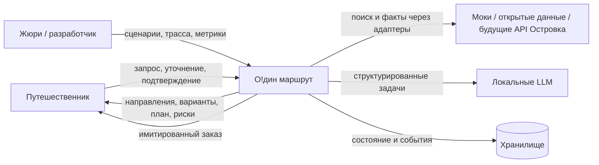
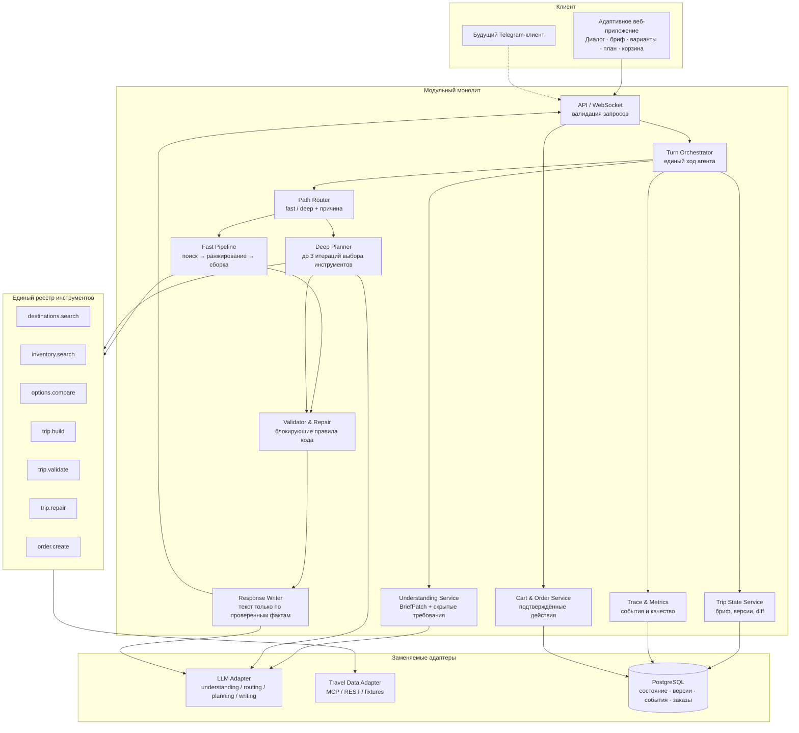
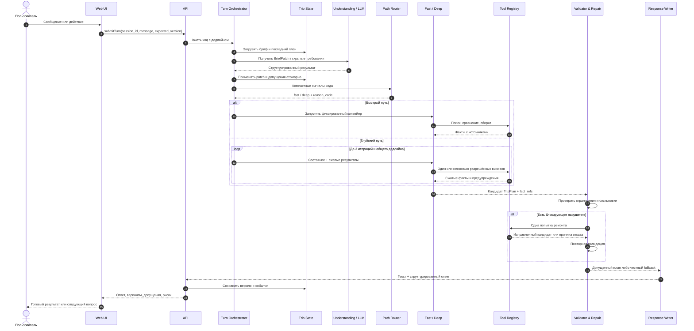
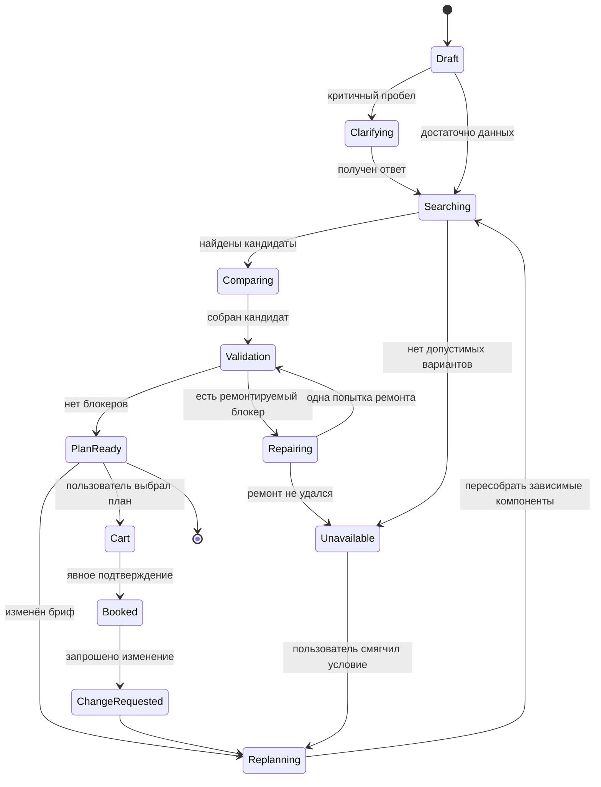
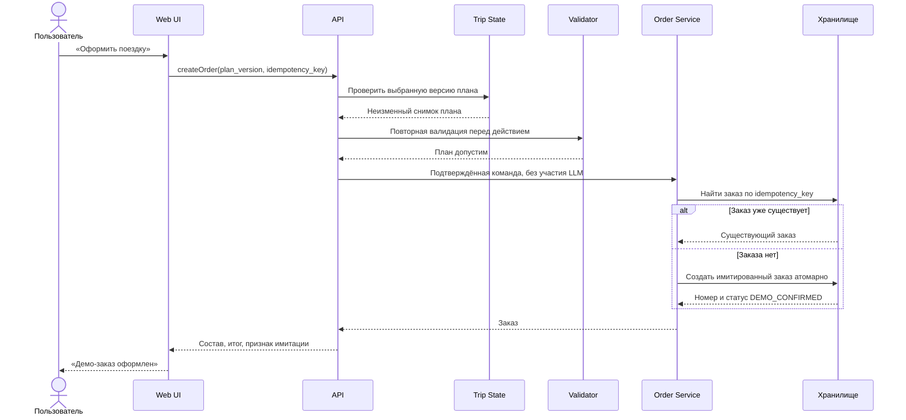
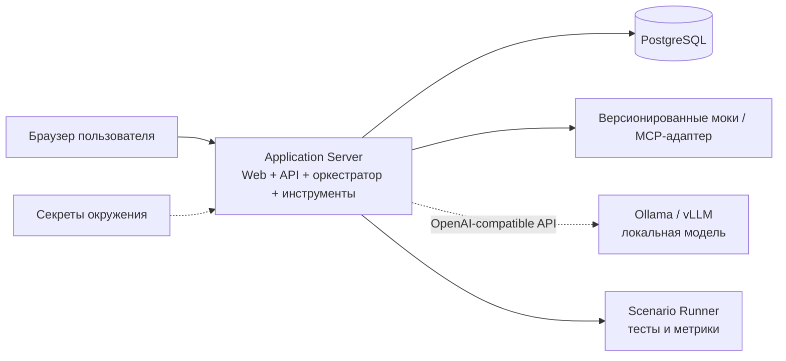
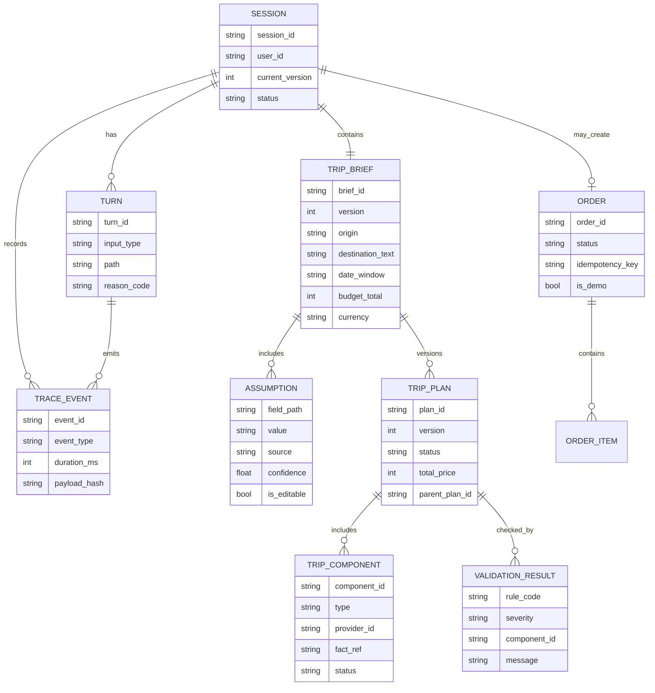

# «О!дин маршрут»
## Требования и архитектура AI-агента путешествий

**Проект:** трек «О!дин запрос», О! Хакатон Островка  
**Версия документа:** 0.1  
**Дата:** 28 октября 2026  
**Статус:** рабочая спецификация для команды, до реализации прототипа  
**Основание:** описание трека, Q&A от 27.10.2026, документ `search_travel_arch.pdf`

---

## 1. Назначение документа

Документ определяет:

- продуктовые границы и критерии успеха;
- функциональные и нефункциональные требования;
- архитектуру быстрого и глубокого путей обработки запроса;
- модель данных, контракты инструментов и правила работы агента;
- сценарии приёмки, метрики качества и состав MVP.

Термины **MUST / необходимо**, **SHOULD / желательно**, **MAY / возможно** обозначают обязательные, рекомендуемые и необязательные требования соответственно.

Приоритеты:

- **P0** — обязательно для сквозного MVP и сдачи;
- **P1** — сильно усиливает решение, реализуется после стабилизации P0;
- **P2** — развитие продукта после хакатона.

---

## 2. Видение продукта

### 2.1. Формулировка

> Пользователь одним сообщением описывает желаемую поездку. Агент превращает сообщение в проверенный, объяснимый и изменяемый план путешествия, а затем по явному подтверждению пользователя имитирует оформление заказа.

Рабочее название — **«О!дин маршрут»**. Это не чат поверх поисковой выдачи, а система управления состоянием поездки с агентными возможностями.

### 2.2. Ценность для пользователя

- Заменить десяток вкладок одним диалогом и единым планом.
- Понимать, почему предложен конкретный вариант и каковы его компромиссы.
- Менять условия без повторного заполнения поисковой формы.
- Видеть риски состыковок, бюджета и ограничений до покупки.

### 2.3. Ценность для Островка

- Сокращение пути от вдохновения до бронирования.
- Рост конверсии, среднего чека и возвращаемости.
- Продажа поездки целиком, а не только отдельного отеля.
- Более точное соответствие отеля гостю и снижение разочарований.
- Переиспользование модулей понимания запроса, ранжирования, проверки и пересборки в существующих продуктах.

### 2.4. Архитектурная идея

Система имеет два пути обработки, которые используют **одни и те же инструменты и проверки**:

- **Быстрый путь** — детерминированный конвейер для однозначных запросов, кнопок и простых изменений.
- **Глубокий путь** — ограниченный агентный цикл для размытых запросов, конфликтов, компромиссов и повторных неудач.

**Код отвечает за факты, состояние, побочные действия и допуск ответа. Модели отвечают за интерпретацию смысла, выбор инструментов в глубоком пути и формулирование текста.**

### 2.5. Принципы

1. **Никаких выдуманных фактов.** Цена, время, доступность, погода и условия берутся только из инструментов.
2. **Единое состояние поездки.** Каждое сообщение создаёт изменение брифа, а не новый независимый поиск.
3. **Происхождение каждого допущения.** Источник значения: `user`, `profile`, `pattern`, `default`.
4. **Минимум вопросов.** Уточняется только то, без чего нельзя безопасно продолжить.
5. **Прозрачный выбор пути.** Решение `fast` или `deep` записывается в трассу с причиной.
6. **Детерминированные ограничения.** Даты, бюджет, состыковки и ограничения проверяются кодом.
7. **Человек подтверждает действия.** Выбор, корзина и заказ выполняются по явной команде пользователя.
8. **Честная деградация.** При недоступности модели система использует безопасный резервный сценарий и сообщает об ограничении.
9. **Моки не маскируются под реальные данные.** Источник и признак синтетичности видны в API и интерфейсе.

---

## 3. Цели, метрики и границы

### 3.1. Продуктовые цели

- G1. Дать готовый сценарий поездки по одному естественноязычному запросу.
- G2. Поддержать пользователя, который ещё не выбрал направление.
- G3. Сравнивать варианты по пользовательской значимости, а не только по цене.
- G4. Объяснять рекомендации, компромиссы и риски.
- G5. Проверять совместимость компонентов поездки.
- G6. Пересобирать план при изменении условий без потери остального контекста.
- G7. Довести сценарий до имитированного оформления заказа.

### 3.2. Нефункциональные бизнес-цели

- G8. Обеспечить замену моков на реальные API без переписывания оркестратора.
- G9. Обеспечить замену локальных моделей без изменения бизнес-логики.
- G10. Дать жюри воспроизводимый сценарий, трассу решений и набор проверок.

### 3.3. Целевые метрики MVP

| Метрика | Цель MVP | Способ измерения |
|---|---:|---|
| Доля успешно завершённых эталонных сценариев | ≥ 90% | Автотесты сценариев |
| Доля ответов без блокирующих нарушений ограничений | 100% | Детерминированный валидатор |
| Доля числовых утверждений с источником в инструменте | 100% | Проверка ссылок на факты |
| Среднее число уточняющих вопросов до первой рекомендации | ≤ 1 | Журнал ходов |
| Время до первой рекомендации в автономном демо-режиме | P95 ≤ 4 с | Трассировка быстрого пути |
| Успешная пересборка при простом изменении | ≥ 95% | Набор пар «план → изменение» |
| Сохранение неизменённых ограничений при пересборке | 100% | Сравнение версий брифа |
| Успешный резервный ответ при недоступной модели | 100% | Тест отключения модели |

Числа являются проектными целями, а не заявлением об уже достигнутом результате.

### 3.4. Границы MVP

**Входит в P0:**

- текстовый запрос на русском языке;
- адаптивный веб-интерфейс;
- единый бриф и версия состояния поездки;
- допущения с источниками и возможностью исправления;
- быстрый и глубокий пути;
- моковые данные отелей, транспорта, трансферов и направлений;
- три стратегии рекомендаций: «дешевле», «быстрее», «комфортнее»;
- объяснение, компромиссы и риски;
- сборка поездки, корзина и имитация заказа;
- проверка ограничений и одна попытка ремонта;
- пересборка плана и отображение изменений;
- трассировка и базовые метрики.

**P1, если останется время:**

- персонализация между сессиями;
- программа по дням и карта;
- напоминания и изменения после покупки;
- расширенный набор открытых данных;
- Telegram-бот как второй клиент того же API.

**Не входит в хакатонный MVP:**

- реальная оплата и реальное бронирование;
- доступ к закрытым системам Островка;
- голосовой ввод и анализ фотографий;
- микросервисная распределённая платформа;
- мультиагентность ради мультиагентности;
- автономное оформление заказа без подтверждения человека.

---

## 4. Акторы и основные сценарии

### 4.1. Акторы

| Актор | Потребность |
|---|---|
| Путешественник | Получить подходящую поездку без ручного поиска и сверки |
| Островок | Провести пользователя до покупки и переиспользовать компоненты |
| Отель | Получать релевантных гостей и меньше несоответствующих ожиданий |
| Проверяющий / жюри | Быстро запустить систему, проверить незнакомые запросы и увидеть архитектуру |
| Разработчик | Заменять модели и источники данных через стабильные контракты |
| Аналитик | Оценивать качество сценариев, ошибки и конверсию |

### 4.2. Основной happy path

1. Пользователь пишет: «Хочу к тёплому морю в ноябре, вдвоём, до 150 тысяч, без долгого перелёта».
2. Сервис понимания создаёт `BriefPatch`: море, ноябрь, двое, бюджет, ограничение на длительность пути.
3. Недостающие поля заполняются допущениями с источником либо задаётся один критичный вопрос.
4. Оркестратор выбирает путь и записывает причину.
5. Инструменты находят направления и компоненты поездки.
6. Ранжирование формирует три разных варианта.
7. Валидатор проверяет бюджет, даты, доступность и состыковки.
8. Пользователь получает варианты с объяснением и компромиссами.
9. Пользователь выбирает вариант; система собирает поездку и корзину.
10. Пользователь подтверждает оформление; система создаёт имитированный заказ.

### 4.3. Пересборка плана

1. Пользователь пишет: «А если на два дня позже и с собакой?».
2. Сервис понимания возвращает только изменения: сдвиг дат и новое ограничение `pet=true`.
3. Система сохраняет прежние назначение, бюджет, состав гостей и предпочтения.
4. Выбирается быстрый путь, если нет конфликта; иначе глубокий.
5. Затрагиваются только зависимые компоненты: доступность отеля, транспорт, трансфер.
6. Пользователь видит diff: что сохранено, что изменилось, почему и насколько изменилась цена.

### 4.4. Конфликт требований

Если бюджет несовместим с обязательными условиями, система MUST NOT скрывать конфликт или подменять условия. Она предлагает явные альтернативы:

- увеличить бюджет;
- изменить даты;
- снизить уровень комфорта;
- выбрать другое направление;
- отказаться от необязательного пожелания.

### 4.5. Недоступность модели

- Простые команды и кнопки продолжают работать кодом.
- Для понятного запроса допускается детерминированный разбор и быстрый путь.
- Для смысловой неоднозначности система задаёт короткий уточняющий вопрос либо сообщает об ограничении.
- Система MUST NOT имитировать «рассуждение» модели или выдавать непроверенный план за полноценный.

---

## 5. Функциональные требования

### 5.1. Понимание запроса и управление брифом

| ID | Приоритет | Требование | Критерий приёмки |
|---|---|---|---|
| FR-001 | P0 | Система MUST принимать естественноязычное сообщение и извлекать явные параметры поездки | В `BriefPatch` корректно попадают направление, даты, гости, бюджет и ограничения, если они выражены в запросе |
| FR-002 | P0 | Система MUST представлять сообщение как изменение текущего брифа, а не как новый бриф | При «на два дня позже» остальные поля сохраняются |
| FR-003 | P0 | Система MUST выделять скрытые требования и отделять их от явных фактов | «С ребёнком» влияет на номер, трансфер и безопасность, но помечается как выведенное требование |
| FR-004 | P0 | Каждое значение MUST иметь источник `user`, `profile`, `pattern` или `default` | В API и UI можно увидеть происхождение значения |
| FR-005 | P0 | Система SHOULD задавать не более одного вопроса за ход и только при критичном пробеле | Анкета из последовательных необязательных вопросов отсутствует |
| FR-006 | P0 | Пользователь MUST иметь возможность исправить допущение | После исправления создаётся новая версия брифа, источник меняется на `user` |
| FR-007 | P0 | Система MUST различать жёсткие ограничения и гибкие пожелания | При конфликте жёсткие ограничения не нарушаются; компромисс предлагается только для гибких |
| FR-008 | P1 | Система SHOULD учитывать профиль и прошлые предпочтения | Значение профиля не перекрывает явное значение пользователя |

### 5.2. Оркестрация и агентное поведение

| ID | Приоритет | Требование | Критерий приёмки |
|---|---|---|---|
| FR-101 | P0 | Оркестратор MUST выбирать `fast` или `deep` по явным правилам | Для каждого хода в трассе есть путь и машиночитаемая причина |
| FR-102 | P0 | Кнопки выбора, корзины и оплаты MUST обрабатываться без модели | Отключение модели не блокирует эти действия |
| FR-103 | P0 | Полный однозначный запрос и простое изменение SHOULD идти по быстрому пути | Выполняется один ограниченный конвейер без агентного цикла |
| FR-104 | P0 | Конфликт, компромисс, смысловая неоднозначность и повтор неудачи SHOULD идти по глубокому пути | Планировщик получает компактное состояние и список разрешённых инструментов |
| FR-105 | P0 | Глубокий путь MUST иметь ограничение числа итераций и времени | Не более `N=3` итераций и общего дедлайна 40 с для модельной части |
| FR-106 | P0 | Оба пути MUST вызывать один реестр инструментов | Нет отдельных реализаций поиска или валидации для каждого пути |
| FR-107 | P0 | Планировщик MUST NOT напрямую изменять заказ, корзину или факты инвентаря | Все изменения выполняются типизированными командами после подтверждения |
| FR-108 | P1 | Независимые вызовы инструментов SHOULD выполняться параллельно | В трассе видны параллельные группы и время каждого вызова |

### 5.3. Поиск, сравнение и объяснение

| ID | Приоритет | Требование | Критерий приёмки |
|---|---|---|---|
| FR-201 | P0 | При неизвестном направлении система MUST предлагать несколько направлений с ценой, погодой и временем в пути | Вариант содержит источники фактов и объяснение соответствия |
| FR-202 | P0 | Система MUST искать отели и SHOULD искать перелёты/ЖД и трансферы через адаптеры | Смена мока на другой провайдер не меняет оркестратор |
| FR-203 | P0 | Жёсткая фильтрация MUST предшествовать ранжированию | Вариант с нарушением жёсткого ограничения не получает высокий балл |
| FR-204 | P0 | Система MUST выдавать до трёх содержательно разных стратегий: «дешевле», «быстрее», «комфортнее» | Это не три одинаковых отеля с разными подписями |
| FR-205 | P0 | Сравнение MUST учитывать полную стоимость поездки | В стоимость включаются все выбранные обязательные компоненты |
| FR-206 | P0 | Для каждой рекомендации MUST указываться причина, компромисс и риск | Пользователь видит, чем вариант лучше и чем пришлось пожертвовать |
| FR-207 | P0 | Пользователь MUST иметь возможность сравнить варианты по значимым атрибутам | Цена, время в пути, отмена, питание, расположение и ограничения сопоставимы |
| FR-208 | P1 | Система SHOULD показывать вклад факторов в итоговый балл | Объяснение не сводится к безусловному «лучший вариант» |

### 5.4. Сборка, проверка и оформление

| ID | Приоритет | Требование | Критерий приёмки |
|---|---|---|---|
| FR-301 | P0 | Система MUST собирать выбранные компоненты в единый `TripPlan` | План содержит отель, транспорт, трансфер и хронологию, если они выбраны |
| FR-302 | P0 | Валидатор MUST проверять даты, бюджет, доступность, состав гостей и состыковки | Нарушения имеют код, серьёзность и ссылку на компонент |
| FR-303 | P0 | Блокирующее нарушение MUST NOT попадать в ответ как готовый к покупке план | Статус плана `validation_failed`, кнопка оформления недоступна |
| FR-304 | P0 | Система SHOULD выполнить не более одной автоматической попытки ремонта | В трассе видны причина, действие и результат ремонта |
| FR-305 | P0 | При неуспешном ремонте система MUST дать честный запасной ответ | Указывается неразрешимое ограничение и доступные действия пользователя |
| FR-306 | P0 | Выбор варианта MUST быть явной командой пользователя | Агент не меняет выбранный вариант без новой команды |
| FR-307 | P0 | Корзина MUST содержать итоговую стоимость и состав компонентов | Пользователь может проверить заказ до подтверждения |
| FR-308 | P0 | Оформление MUST быть идемпотентной имитацией | Повтор запроса с тем же ключом не создаёт второй заказ |
| FR-309 | P0 | В UI и заказе MUST быть указано, что оплата и бронирование имитированы | Нет утверждения о реальной покупке |

### 5.5. Пересборка, состояние и качество

| ID | Приоритет | Требование | Критерий приёмки |
|---|---|---|---|
| FR-401 | P0 | Система MUST пересобирать зависимые компоненты при изменении брифа | Изменение дат вызывает повторную проверку всех зависимых от дат компонентов |
| FR-402 | P0 | Система MUST сохранять незатронутые пользовательские решения, если они остаются валидными | Например, выбранный отель сохраняется при изменении только трансфера |
| FR-403 | P0 | Система MUST формировать diff версий плана | Изменения цены, дат и компонентов подтверждаются данными |
| FR-404 | P0 | Состояние сессии MUST сохраняться между запросами | После повторного открытия можно продолжить текущую поездку |
| FR-405 | P0 | Каждый ход MUST создавать трассу | Содержит вход, версию брифа, путь, вызовы, проверки и результат без секретов |
| FR-406 | P0 | Система MUST иметь автоматический набор эталонных сценариев | Метрики воспроизводятся одной командой |
| FR-407 | P1 | Система SHOULD поддерживать действия после покупки | Изменение дат создаёт новую проверку заказа, а не перезаписывает его молча |
| FR-408 | P1 | Система SHOULD сохранять переносимые предпочтения пользователя | Профиль можно просмотреть и сбросить |

---

## 6. Нефункциональные требования

### 6.1. Производительность и надёжность

| ID | Требование | Целевой показатель / проверка |
|---|---|---|
| NFR-001 | Первый видимый статус обработки | ≤ 300 мс после отправки запроса |
| NFR-002 | Быстрый путь на моковых данных без внешней LLM | P95 ≤ 4 с |
| NFR-003 | Глубокий путь | Прогресс виден непрерывно; общий лимит 40–45 с |
| NFR-004 | Таймауты инструментов | Индивидуальный таймаут 2–8 с; отмена по дедлайну хода |
| NFR-005 | Деградация | Отключение LLM или одного источника не приводит к падению всего сценария |
| NFR-006 | Идемпотентность | Повтор чтения безопасен; оформление заказа защищено ключом идемпотентности |
| NFR-007 | Целостность состояния | Обновление брифа использует ожидаемую версию; конфликт версий не перезаписывает чужие изменения |
| NFR-008 | Восстановление | Сессия и последняя валидная версия плана сохраняются после перезапуска backend |

### 6.2. Качество и достоверность

| ID | Требование | Целевой показатель / проверка |
|---|---|---|
| NFR-101 | Фактическая обоснованность | Каждое число и проверяемый факт имеет `fact_ref` на результат инструмента |
| NFR-102 | Детерминированная безопасность | Модель не может отменить результат блокирующего валидатора |
| NFR-103 | Воспроизводимость | Моки имеют фиксированную версию и seed; тесты не зависят от текущего времени |
| NFR-104 | Честность данных | `is_mock`, `source`, `observed_at` присутствуют в ответах провайдеров |
| NFR-105 | Управляемая неопределённость | Неопределённые значения не выдаются за факты; отображаются как допущения или вопросы |

### 6.3. Переиспользуемость и сопровождаемость

| ID | Требование | Проверка |
|---|---|---|
| NFR-201 | Заменяемость провайдеров | Реализация нового адаптера не требует изменений в оркестраторе |
| NFR-202 | Заменяемость моделей | Модельные роли задаются конфигурацией; идентификаторы моделей отсутствуют в бизнес-логике |
| NFR-203 | Типизированные границы | Все входы/выходы инструментов и API валидируются схемами |
| NFR-204 | Модульный монолит | Модули имеют отдельные публичные контракты и могут быть вынесены в сервисы позднее |
| NFR-205 | Чистота инфраструктуры | Секреты, URL моделей и особенности провайдеров не проникают в доменную логику |
| NFR-206 | Документация запуска | Запуск, конфигурация, тестовые сценарии и ограничения описаны в README |

### 6.4. Безопасность и приватность

| ID | Требование | Проверка |
|---|---|---|
| NFR-301 | Секреты только на сервере | API-ключи отсутствуют в клиентском bundle, репозитории и трассах |
| NFR-302 | Минимизация данных | Для MVP не запрашиваются паспортные и платёжные данные |
| NFR-303 | Санитизация логов | Персональные данные и секреты маскируются перед записью |
| NFR-304 | Подтверждение побочных действий | Нет оформления заказа по косвенной фразе без явного подтверждения |
| NFR-305 | Устойчивость к prompt injection | Содержимое внешних источников считается данными, а не инструкциями агенту |
| NFR-306 | Управление профилем | Пользователь может удалить сохранённые предпочтения |

### 6.5. UX, доступность и совместимость

| ID | Требование | Целевой показатель / проверка |
|---|---|---|
| NFR-401 | Адаптивность | Основной сценарий работает на ширинах 375, 768, 1024 и 1440 px без горизонтальной прокрутки |
| NFR-402 | Доступность | Ключевой путь управляется клавиатурой; контраст соответствует WCAG 2.2 AA |
| NFR-403 | Обратная связь | Есть состояния загрузки, пустого результата, ошибки, деградации и успеха |
| NFR-404 | Понятность | Термины «быстрый/глубокий путь» не перегружают основной пользовательский сценарий; подробности доступны в трассе |
| NFR-405 | Локализация | MVP — русский язык; доменные строки отделены от логики |
| NFR-406 | Ограничение когнитивной нагрузки | Не более трёх основных рекомендаций и одного главного действия на экране |

### 6.6. Ресурсы и стоимость

| ID | Требование | Проверка |
|---|---|---|
| NFR-501 | Local-first | Поддерживается OpenAI-compatible локальный inference без внешнего LLM API |
| NFR-502 | Независимость демо | Автономный режим работает на фиксированных данных и правилах |
| NFR-503 | Ограничение контекста | Планировщик получает компактное состояние и сжатые результаты, а не всю историю без фильтрации |
| NFR-504 | Контроль ресурсов | Число итераций, токенов, параллельных вызовов и время ограничены конфигурацией |

---

## 7. Архитектура системы

### 7.1. Архитектурный стиль

Для MVP выбирается **модульный монолит с выделенными адаптерами моделей и данных**.

Причины:

- быстрый запуск и единая трассировка хода;
- отсутствие распределённых транзакций между корзиной, состоянием и заказом;
- простое локальное развёртывание;
- возможность переиспользовать отдельные модули;
- возможность позднее вынести inference, поиск или оформление в отдельные сервисы без изменения доменных контрактов.

### 7.2. Контекстная диаграмма



### 7.3. Контейнерная архитектура



### 7.4. Ответственность модулей

| Модуль | Отвечает | Не отвечает |
|---|---|---|
| Web UI | Диалог, редактирование допущений, выбор, сравнение, подтверждение | Бизнес-расчёты и доверие к числам клиента |
| API | Схемы запросов, аутентификация сессии, идемпотентность, поток статусов | Принятие туристических решений |
| Turn Orchestrator | Последовательность хода, дедлайны, вызов модулей | Смысл запроса и генерация прозы |
| Understanding Service | `BriefPatch`, скрытые требования, уверенность | Дописывание недостающих фактов без источника |
| Path Router | `fast` / `deep` и причина | Поиск отелей и выбор «лучшего» варианта |
| Fast Pipeline | Детерминированный набор вызовов | Свободный агентный цикл |
| Deep Planner | Выбор следующих инструментов в ограниченном цикле | Прямая запись в состояние и заказ |
| Tool Registry | Единые контракты, таймауты, политики повторов | Смысловое рассуждение |
| Ranking Service | Жёсткие фильтры, баллы, стратегии вариантов | Скрытое изменение ограничений |
| Validator & Repair | Допуск плана, коды нарушений, одна попытка ремонта | Генерация правдоподобного текста вместо исправления |
| Response Writer | Понятный текст по структуре ответа | Новые числа и факты |
| Trip State Service | Версии брифа/плана, зависимость компонентов, diff | Вызов LLM |
| Cart & Order | Явные команды пользователя, идемпотентная имитация | Самостоятельное решение агента о покупке |
| Trace & Metrics | Причины решений, задержки, качество, ошибки | Хранение секретов и чувствительных данных |

### 7.5. Быстрый и глубокий пути

| Свойство | Быстрый путь | Глубокий путь |
|---|---|---|
| Когда применяется | Полный запрос, кнопка, простое изменение | Подтекст, конфликт, неоднозначность, повтор неудачи |
| Управление | Код | Код + ограниченный planner |
| Число шагов | Фиксированный конвейер | До 3 итераций |
| Инструменты | Общий реестр | Тот же общий реестр |
| Текст | По готовой структуре фактов | По той же структуре фактов |
| Проверка | Обязательная | Обязательная, идентичная |
| Деградация | Полностью возможна без LLM | Безопасный вопрос или честное ограничение |
| Целевое время | До 4 с в автономном режиме | До 40–45 с с видимым прогрессом |

### 7.6. Логика выбора пути

```python
def choose_path(turn, session) -> PathDecision:
    # Жёсткие правила исполняются без модели.
    if turn.is_button:
        return fast("button_action")

    if session.same_wish_again(turn):
        return deep("repeated_unsatisfied_request")

    if session.last_build_failed or session.has_constraint_conflict:
        return deep("constraint_conflict")

    if turn.is_first and turn.brief_is_complete:
        return fast("complete_unambiguous_request")

    if turn.patch_is_one_plain_field:
        return fast("simple_brief_patch")

    # Серая зона: необязательный компактный классификатор.
    decision = gray_zone_classifier.decide(compact(turn, session))
    if decision is None:
        return deep("classifier_unavailable_safe_default")

    if decision.has_subtext or decision.confidence < 0.5:
        return deep("semantic_uncertainty")

    return fast("classifier_confident")
```

Требования к `PathDecision`:

```json
{
  "path": "deep",
  "reason_code": "constraint_conflict",
  "rule": "session.has_constraint_conflict",
  "classifier_used": false,
  "decided_at": "2026-10-28T12:00:00Z"
}
```

### 7.7. Модельные роли

Исходные названия моделей из командной схемы заменяются на роли. Это позволяет использовать одну или несколько локальных моделей без переписывания системы.

| Роль | Задача | Формат результата | Резервное поведение |
|---|---|---|---|
| `understanding` | Извлечь изменения и скрытый смысл | `BriefPatch` по JSON Schema | Правила + уточняющий вопрос |
| `gray_zone_classifier` | Оценить подтекст и уверенность | Маленький JSON | Выбрать `deep` |
| `planner` | Выбрать инструменты и завершить цикл | `PlannerAction` | Ограниченный конвейер или честный отказ |
| `writer` | Сформулировать ответ по проверенной структуре | Текст без новых фактов | Шаблонный текст |

**Правило:** модель не получает права на запись в БД, корзину или заказ. Она возвращает данные строго определённой схемы, которые затем проверяются кодом.

---

## 8. Диаграммы поведения

### 8.1. Sequence: один ход агента



### 8.2. State: жизненный цикл поездки



### 8.3. Sequence: безопасное оформление



### 8.4. Диаграмма развёртывания MVP



Рекомендуемый локальный запуск: `docker compose` для приложения, PostgreSQL и необязательного inference-контейнера. Автономный режим не требует запуска модели.

---

## 9. Продуктовый контекст реального Островка

### 9.1. Как этот раздел использовать

Раздел отделяет наблюдаемые возможности текущего продукта от предложений команды. Проверены главная страница `ostrovok.ru` и официальные материалы Островка, дата обращения — 28.10.2026. Реальное бронирование и оплата не выполнялись.

Обозначения:

- **Наблюдается** — подтверждается текущей страницей или официальной документацией;
- **Предлагается** — проектное решение команды, которое не приписывается существующему продукту;
- **Требует подтверждения** — нельзя надёжно утверждать без доступа к внутренним системам.

### 9.2. Соответствие текущего продукта и решения команды

| Область | Что подтверждено у Островка | Следствие для нашего решения |
|---|---|---|
| Базовый поиск | Поиск по направлению, заезду, выезду, гостям и номеру | Агент должен заполнять и изменять тот же минимальный поисковый контекст, но принимать его на естественном языке |
| Типы размещения | Отели, хостелы, апартаменты; в официальных материалах также упоминаются гостевые дома и виллы | `accommodation_type` — часть брифа и фильтров, а не только текстовое пожелание |
| Фильтры | Тип объекта, цена, питание, бассейн, Wi-Fi, близость к пляжу или центру | Эти параметры включаются в схему жёстких/гибких ограничений и в объяснимое ранжирование |
| Отзывы и доверие | На главной заявлены достоверные отзывы путешественников и отзывы TripAdvisor | В объяснении можно использовать рейтинг и отзывы только с источником; нельзя обобщать их без данных |
| Условия тарифа | В официальных материалах выделяются детали тарифа, отмена, заезд, налоги, сборы и депозиты | Валидатор и UI должны учитывать полную стоимость, правила отмены и время заселения |
| Оплата | Заявлены оплата онлайн или в отеле, а также разные условия предоплаты | В демо-корзине следует сохранять `payment_type`; имитация не должна показывать ввод реальных платёжных данных |
| Подтверждение | Ваучер и подтверждение доступны в «Моих бронированиях» | Демо-заказ должен иметь постоянный идентификатор, состав и статус, а не исчезающее сообщение в чате |
| Отмена и изменения | Самостоятельная отмена доступна в личном кабинете; последствия зависят от политики отеля | Перед изменением/отменой агент обязан повторно проверить политику и показать последствия |
| Поддержка | Заявлена круглосуточная поддержка | При неразрешимом конфликте предусматривается handoff к поддержке, а не бесконечный агентный цикл |
| GURU | Уровни, скидки, баллы; в материалах упоминаются бонусы раннего заезда, завтрака и другие преимущества | Полная цена должна отделять базовый тариф, скидку и бонусы; профильные преимущества не выдумываются |
| Мобильное приложение | Заявлены секретные цены и офлайн-доступ к бронированиям | Цена зависит от канала и должна иметь контекст; P2 — доступ к демо-заказу после покупки |
| Транспорт и трансферы | Авиабилеты, ЖД и трансферы подтверждены материалами B2B.Ostrovok | Для B2C-прототипа это независимые адаптеры; наличие единой потребительской корзины Островка не утверждается |

### 9.3. Что является именно нашим нововведением

1. Естественноязычный запрос вместо обязательного предварительного выбора направления и дат.
2. Подбор направления, если пользователь знает только желаемый опыт поездки.
3. Единый изменяемый `TripBrief` поверх существующих поисковых параметров.
4. Сборка отеля, транспорта и трансфера в единый проверенный сценарий.
5. Проверка состыковок и полной стоимости до выбора.
6. Три объяснимые стратегии результата вместо одной сортировки.
7. Пересборка только затронутых компонентов и diff изменений.
8. Трасса решений для жюри, аналитики и последующей интеграции.

### 9.4. Что нельзя утверждать без внутреннего доступа

- Что у команды есть доступ к реальному инвентарю или ценам Островка.
- Что моковая корзина совместима с production API Островка.
- Что в потребительском сервисе уже есть пакетное бронирование всех компонентов.
- Что профиль, прошлые поездки и просмотры доступны нашему приложению.
- Что скидка GURU применима к любому моковому тарифу.
- Что открытые данные всегда отражают актуальную доступность.

### 9.5. Источники по текущему продукту

1. [Ostrovok.ru — главная страница](https://ostrovok.ru/) — базовый сервис, размещение, оплата, поддержка, приложение.
2. [Гид по онлайн-безопасности для пользователей Ostrovok.ru](https://blog.ostrovok.ru/gid-po-onlajn-bezopasnosti/) — фильтры, тарифы, дополнительные сборы, «Мои бронирования».
3. [Программа лояльности GURU](https://ostrovok.ru/about/guru/) — уровни, скидки и баллы.
4. [Как забронировать отель без предоплаты](https://blog.ostrovok.ru/kak-zabronirovat-otel-bez-predoplaty/) — завершение бронирования, подтверждение и ваучер.
5. [Правила бронирования](https://ostrovok.ru/legal/order/agreement/bg/524/) — отмена, изменение и зависимость последствий от политики отеля.
6. [Пакет тревел-услуг на B2B.Ostrovok](https://b2b.ostrovok.ru/blog/kak-sformirovat-paket-trevel-uslug/) — отель с авиабилетом или трансфером в B2B-контексте.

---

## 10. Модель данных

### 10.1. Основные сущности



### 10.2. TripBrief

`TripBrief` — единственный источник истины о намерении пользователя. Модель не передаётся целиком между всеми компонентами: каждый потребитель получает только нужную проекцию.

Рекомендуемая структура:

```json
{
  "brief_id": "brf_01",
  "version": 4,
  "origin": {
    "value": "Москва",
    "source": "profile",
    "confidence": 0.92
  },
  "destination": {
    "mode": "open",
    "text": "тёплое море",
    "candidates": []
  },
  "dates": {
    "check_in": null,
    "check_out": null,
    "month": "2026-11",
    "flexible_days": 3,
    "source": "user"
  },
  "travelers": {
    "adults": 2,
    "children": [],
    "pets": false,
    "rooms": 1
  },
  "budget": {
    "amount": 150000,
    "currency": "RUB",
    "scope": "whole_trip",
    "hard": true,
    "source": "user"
  },
  "hard_constraints": [
    { "type": "max_travel_duration", "value": 300, "unit": "min", "source": "user" }
  ],
  "soft_preferences": [
    { "type": "near_beach", "weight": 0.8, "source": "user" },
    { "type": "breakfast", "weight": 0.5, "source": "pattern" }
  ],
  "assumptions": [
    {
      "field_path": "travelers.rooms",
      "value": 1,
      "source": "default",
      "reason": "Для двух взрослых принят один номер",
      "editable": true
    }
  ]
}
```

### 10.3. BriefPatch

Модель понимания возвращает только изменения и не собирает весь бриф заново:

```json
{
  "set": [
    { "path": "dates.month", "value": "2026-11", "source": "user" },
    { "path": "budget.amount", "value": 50000, "source": "user" }
  ],
  "shift": [
    { "path": "dates", "days": 2 }
  ],
  "add_constraints": [
    { "type": "pet_friendly", "hard": true, "source": "user" }
  ],
  "inferred_needs": [
    { "type": "pet_policy_verification", "reason": "Путешественник едет с собакой" }
  ],
  "confidence": 0.88,
  "clarification_required": false
}
```

Запрещённые поля, которые модель не может установить: `price`, `availability`, `order_status`, `validation_status`, `fact_ref`, `user_confirmation`.

### 10.4. TripPlan

`TripPlan` — версированный снимок конкретной поездки:

- `plan_id`, `version`, `parent_plan_id`;
- `brief_version`;
- компоненты и их порядок во времени;
- полная стоимость и валюта;
- стратегия (`cheaper`, `faster`, `comfort`);
- объяснение соответствия;
- список компромиссов и рисков;
- `fact_refs`;
- результаты валидации;
- статус `draft`, `ready`, `validation_failed`, `selected`, `booked_demo`;
- `created_at`, `expires_at`, если провайдер ограничивает актуальность цены.

### 10.5. Provenance

Каждый проверяемый факт имеет общий конверт:

```json
{
  "fact_ref": "fact_7f21",
  "tool_call_id": "call_109",
  "source": "mock_ostrovok_v3",
  "provider_item_id": "hotel_042",
  "observed_at": "2026-10-28T12:00:00Z",
  "valid_until": null,
  "is_mock": true,
  "payload_hash": "sha256:..."
}
```

Ответ пользователя ссылается на `fact_ref`, а не копирует факты без происхождения.

---

## 11. Контракты инструментов

### 11.1. Общие правила

- Все инструменты вызываются через `ToolRegistry`.
- Вход и выход валидируются схемами.
- Каждый вызов получает `trace_id`, `tool_call_id`, `deadline` и `session_id`.
- Ответ содержит факты, предупреждения и `Provenance`.
- Инструмент не вызывает LLM для получения чисел.
- Побочные инструменты отделены от read-only.
- Внешний текст и описания отелей считаются недоверенными данными, а не инструкциями.

### 11.2. Реестр MVP

| Инструмент | Назначение | Побочный эффект | Идемпотентность |
|---|---|---|---|
| `destinations.search` | Найти направления по опыту, сезону, бюджету и пути | Нет | Да |
| `inventory.search` | Найти отель/транспорт/трансфер по параметрам | Нет | Да |
| `route.check` | Проверить аэропорты, длительность и совместимость маршрута | Нет | Да |
| `options.compare` | Отфильтровать и ранжировать кандидатов | Нет | Да |
| `trip.build` | Собрать компоненты в версионный план | Создаёт draft | По ключу сборки |
| `trip.validate` | Проверить план детерминированными правилами | Нет | Да |
| `trip.repair` | Изменить только затронутые компоненты | Создаёт новую версию | По ключу плана и patch |
| `cart.prepare` | Сформировать проверяемый снимок корзины | Создаёт draft cart | Да |
| `order.create_demo` | Создать имитированный заказ после подтверждения | Да | По `idempotency_key` |
| `order.change_demo` | Проверить возможность изменения демо-заказа | Да, P1 | По ключу изменения |

### 11.3. Универсальный ответ инструмента

```json
{
  "tool_call_id": "call_109",
  "status": "ok",
  "data": {},
  "facts": [
    {
      "fact_ref": "fact_7f21",
      "value": 142300,
      "unit": "RUB",
      "source": "mock_ostrovok_v3",
      "is_mock": true,
      "observed_at": "2026-10-28T12:00:00Z"
    }
  ],
  "warnings": [
    { "code": "STALE_RATE", "message": "Цена требует повторной проверки" }
  ],
  "error": null,
  "duration_ms": 86
}
```

### 11.4. Действия планировщика

Глубокий planner может вернуть только одно из действий:

```json
{ "action": "call_tools", "calls": [{ "tool": "destinations.search", "input_ref": "query_01" }] }
```

```json
{ "action": "finish", "candidate_plan_ref": "plan_12", "summary": "Кандидат собран" }
```

```json
{ "action": "ask_user", "question": "Что важнее: сохранить ноябрь или уложиться в 50 000 ₽?", "reason_code": "BUDGET_DATE_CONFLICT" }
```

Прямой текст пользователю из planner не допускается: сначала результат проходит сборку и валидацию.

---

## 12. Ранжирование и объяснимость

### 12.1. Два этапа

**Этап 1 — жёсткие ограничения.** Кандидат отклоняется при нарушении бюджета, дат, вместимости, обязательных условий размещения, транспортных ограничений и других `hard_constraints`.

**Этап 2 — ранжирование допустимых кандидатов.** Используются измеримые факторы:

```text
score =
  w_budget      * budget_fit +
  w_preferences * preference_fit +
  w_logistics   * logistics_fit +
  w_quality     * quality_fit +
  w_flexibility * cancellation_fit -
  w_risk        * risk_penalty
```

Веса определяются профилем и явными приоритетами пользователя. Итоговый балл не заменяет объяснение.

### 12.2. Три стратегии

| Стратегия | Основная цель | Обязательный компромисс в ответе |
|---|---|---|
| «Дешевле» | Минимизировать полную цену | Более долгий путь, район или меньший набор удобств |
| «Быстрее» | Минимизировать общее время в пути и ожидание | Цена или менее удобное время |
| «Комфортнее» | Максимизировать соответствие предпочтениям и качество | Цена и возможные ограничения тарифа |

Если стратегии совпадают, система показывает меньше вариантов, а не создаёт искусственные различия.

### 12.3. Структура рекомендации

Каждая карточка должна отвечать на шесть вопросов:

1. **Почему подходит:** связь с конкретными полями брифа.
2. **Сколько стоит целиком:** цена с обязательными компонентами и сборами, если известны.
3. **Чем жертвуем:** минимум один честный trade-off, если он есть.
4. **Какой риск:** отмена, состыковка, заселение, доступность или неопределённость.
5. **Кому не подойдёт:** ограничение варианта.
6. **Откуда данные:** провайдер, время и признак мока.

---

## 13. Валидация и ремонт

### 13.1. Правила

| Код | Проверка | Серьёзность |
|---|---|---|
| `DATE_ORDER_INVALID` | Выезд позже заезда; хронология компонентов корректна | Blocker |
| `COMPONENT_DATE_MISMATCH` | Даты транспорта, отеля и трансфера совместимы | Blocker |
| `BUDGET_EXCEEDED` | Полная цена не превышает жёсткий бюджет | Blocker |
| `TRAVELER_CAPACITY_MISMATCH` | Номер и транспорт подходят всем гостям | Blocker |
| `PET_POLICY_MISMATCH` | Объект допускает животное с указанными параметрами | Blocker при жёстком условии |
| `ARRIVAL_CHECKIN_GAP` | Время прибытия и заселения совместимы | Warning или Blocker по сценарию |
| `TRANSFER_TOO_TIGHT` | Трансфер учитывает прибытие, буфер и дорогу | Blocker |
| `CANCELLATION_CONFLICT` | Политика отмены соответствует требованию | Blocker или Warning |
| `PRICE_INCOMPLETE` | Неизвестные обязательные сборы не скрыты | Warning; Blocker перед заказом |
| `FACT_SOURCE_MISSING` | У проверяемого факта есть `fact_ref` | Blocker |
| `PLAN_VERSION_STALE` | План соответствует текущей версии брифа | Blocker |
| `USER_SELECTION_CHANGED` | Выбор пользователя не изменён автоматически | Blocker |

### 13.2. Политика ремонта

1. Определить минимальное множество компонентов, связанных с нарушением.
2. Сохранить незатронутые компоненты и пользовательские решения.
3. Вызвать только необходимые read-only инструменты.
4. Создать новую версию плана, не перезаписывая предыдущую.
5. Повторно выполнить **все** правила.
6. Разрешить не более одной автоматической попытки.
7. При неудаче вернуть конкретную причину и доступные решения пользователю.

### 13.3. Проверка текста

Перед отправкой ответа Response Guard проверяет:

- все числа имеют ссылки на факты;
- текст не утверждает реальную покупку вместо демо;
- перечисленные изменения соответствуют diff;
- отсутствуют скрытые компромиссы;
- статус валидации позволяет предложить следующее действие.

При нарушении используется шаблонный ответ на основе структуры, а не свободная повторная генерация.

---

## 14. API и события

### 14.1. Основные операции

| Операция | Назначение | Ключевые входы |
|---|---|---|
| `session.create` | Создать сессию | `locale`, optional `profile_ref` |
| `turn.submit` | Отправить сообщение | `session_id`, `message`, `expected_version` |
| `trip.get` | Получить текущее состояние | `session_id` |
| `assumption.update` | Исправить допущение | `field_path`, `value`, `expected_version` |
| `option.select` | Выбрать вариант | `plan_id`, `plan_version` |
| `cart.prepare` | Подготовить корзину | `selected_plan_version` |
| `order.create_demo` | Подтвердить демо-заказ | `cart_version`, `idempotency_key` |
| `trip.replan` | Применить изменение | `BriefPatch`, `expected_version` |
| `trace.list` | Получить трассу хода | `turn_id` |
| `evaluation.run` | Запустить эталонные сценарии | `suite_version` |

### 14.2. Статусы обработки

Клиент получает события:

- `turn.accepted`;
- `brief.updated`;
- `path.selected`;
- `tool.started` / `tool.completed`;
- `validation.started` / `validation.completed`;
- `response.ready`;
- `turn.failed` / `turn.degraded`.

События не содержат скрытые рассуждения модели. В трассе сохраняются краткие машиночитаемые причины, вызовы и результаты.

### 14.3. Ошибки

```json
{
  "code": "BRIEF_VERSION_CONFLICT",
  "message": "Бриф изменился. Обновите состояние и повторите действие.",
  "retryable": false,
  "details": {
    "expected_version": 3,
    "actual_version": 4
  },
  "trace_id": "trc_81"
}
```

Базовые категории: `VALIDATION_ERROR`, `NOT_FOUND`, `VERSION_CONFLICT`, `PROVIDER_UNAVAILABLE`, `MODEL_UNAVAILABLE`, `DEADLINE_EXCEEDED`, `USER_CONFIRMATION_REQUIRED`, `INTERNAL_ERROR`.

---

## 15. Наблюдаемость и метрики

### 15.1. Трасса хода

Минимальный набор полей:

- `trace_id`, `session_id`, `turn_id`;
- версия брифа до/после;
- путь и `reason_code`;
- модельные роли и признак fallback без секретов;
- вызовы инструментов, длительность, статус, предупреждения;
- кандидаты после жёсткой фильтрации;
- коды валидации и ремонта;
- итоговый статус;
- задержка до первого статуса и до первой рекомендации.

### 15.2. Метрики продукта

- начало сценария → первая рекомендация;
- рекомендация → выбор;
- выбор → демо-заказ;
- число уточнений;
- доля незавершённых сценариев и причина;
- доля пересборок без потери предпочтений;
- доля обращений к поддержке.

### 15.3. Метрики качества агента

- `constraint_violation_rate`;
- `unsupported_fact_rate`;
- `replan_success_rate`;
- `preference_retention_rate`;
- `path_selection_accuracy` на размеченном наборе;
- `model_fallback_success_rate`;
- `tool_error_rate`;
- `p50/p95_latency` по путям.

---

## 16. Приёмочные сценарии

| ID | Запрос / действие | Ожидаемый результат |
|---|---|---|
| AC-01 | «Сочи, 12–19 ноября, двое, до 120 000 ₽» | Fast path; без лишних вопросов; варианты в бюджете |
| AC-02 | «Хочу к тёплому морю в ноябре, недорого, с ребёнком, без долгих перелётов» | Учтены ребёнок и длительность пути; предложены направления, а не только отели |
| AC-03 | Не указан город отправления | Одно критичное уточнение либо явное допущение из профиля |
| AC-04 | После плана: «На два дня позже» | Сохранены бюджет, гости и предпочтения; перепроверены зависимые компоненты |
| AC-05 | После плана: «С нами едет собака» | Добавлено жёсткое ограничение; отель перепроверен; изменения показаны |
| AC-06 | «Бюджет теперь 50 000 ₽, даты менять нельзя» | Нет скрытого превышения; предложены реальные компромиссы или честный отказ |
| AC-07 | Прилёт позже окончания заселения | План не допущен; предложен ремонт или явный риск с действием |
| AC-08 | Пользователь исправляет допущение «один номер» на «два номера» | Новая версия брифа; пересчёт вместимости и цены |
| AC-09 | Двойной клик «Оформить» | Один демо-заказ благодаря идемпотентности |
| AC-10 | Модель недоступна | Кнопки работают; простой запрос получает fallback; сложный не имитирует reasoning |
| AC-11 | Один провайдер недоступен | Предупреждение и частичный результат либо честное ограничение, без падения хода |
| AC-12 | Провайдер вернул текст с инструкцией модели | Текст обработан как данные; политика агента не изменилась |
| AC-13 | Цена включает дополнительный сбор | Полная цена и неизвестные сборы отображены до заказа |
| AC-14 | Пользователь меняет только трансфер | Выбранный отель сохраняется, если остаётся валидным |
| AC-15 | Повторное открытие сессии | Бриф, план и демо-заказ восстановлены |

Для каждого сценария фиксируются вход, ожидаемый путь, ожидаемые инструменты, инварианты и допустимый результат.

---

## 17. Рекомендуемый технологический контур

Выбор технологий является рекомендацией, а не требованием задания.

| Слой | Рекомендация | Причина |
|---|---|---|
| Web | React + TypeScript | Типизированные контракты, адаптивный UI, несколько клиентов в будущем |
| Backend | Python 3.12 + FastAPI + Pydantic | Совпадает с предложенной командой Python-оркестрацией, удобен для AI и MCP |
| Agent runtime | Собственная конечная машина хода, без обязательного agent framework | Управляемость, прозрачные лимиты и меньше скрытого поведения |
| Локальные модели | Ollama для разработки; vLLM или совместимый сервер для более производительного запуска | OpenAI-compatible интерфейс и заменяемость моделей |
| Данные | PostgreSQL + JSONB для версий брифа/плана | Транзакции, сохранение состояния, гибкость схем |
| Инструменты | Python-адаптеры; MCP как один из транспортов | Единые контракты и простая замена моков |
| Очереди | Не нужны в P0; при необходимости — отдельные model jobs | Меньше инфраструктуры для хакатона |
| Тесты | Pytest, контрактные тесты адаптеров, сценарный runner | Проверка требований и воспроизводимость |
| Запуск | Docker Compose | Единый сценарий для команды и жюри |
| Наблюдаемость | Структурные JSON-логи + таблица событий | Трасса без передачи скрытых рассуждений |

### 17.1. Структура backend-модулей

```text
backend/
  api/                 # HTTP/WebSocket, схемы запросов и ответов
  domain/              # TripBrief, TripPlan, команды, инварианты
  orchestration/       # Turn Orchestrator, Path Router, Fast/Deep
  tools/               # Единый реестр и реализации инструментов
  providers/
    travel/            # mock, MCP, открытые API
    llm/               # local OpenAI-compatible, fallback
  validation/          # Правила, repair, Response Guard
  persistence/         # Репозитории, транзакции, миграции
  observability/       # Трасса, метрики, санитизация
  evaluation/          # Эталонные запросы и оценка качества
```

Зависимости направлены внутрь: `api/orchestration → domain`; инфраструктура реализует доменные порты. Домен не импортирует FastAPI, MCP, Ollama или конкретного провайдера.

---

## 18. Ключевые архитектурные решения (ADR)

### ADR-001. Модульный монолит вместо микросервисов

**Решение:** единый backend с независимыми модулями и строгими портами.  
**Почему:** скорость, транзакционность, простая трассировка и запуск.  
**Последствие:** перед выделением сервиса сначала стабилизируется контракт модуля.

### ADR-002. Кодовый оркестратор и ограниченный planner

**Решение:** выбор пути и лимиты контролирует код; planner действует только в deep path.  
**Почему:** предсказуемость, тестируемость, меньше стоимость и задержка.  
**Последствие:** не все запросы требуют большой модели.

### ADR-003. Общие инструменты для fast и deep

**Решение:** один `ToolRegistry`.  
**Почему:** одинаковые факты и проверки независимо от способа рассуждения.  
**Последствие:** меньше дублирования и расхождений в результатах.

### ADR-004. Local-first модельный адаптер

**Решение:** роли моделей через OpenAI-compatible конфигурацию; автономный fallback.  
**Почему:** соответствие ресурсам команды и отсутствие привязки к одному вендору.  
**Последствие:** качество каждой роли измеряется отдельно; нельзя предполагать, что маленькая модель справится со всеми задачами.

### ADR-005. MCP как адаптер, а не как центр архитектуры

**Решение:** домен зависит от портов `TravelDataProvider`, а MCP — одна из реализаций.  
**Почему:** моки и будущие API заменяются без смены оркестратора.  
**Последствие:** для простых fixtures не требуется поднимать MCP-сервер.

### ADR-006. Версионные состояния вместо перезаписи чата

**Решение:** версии брифа и плана, parent links, diff.  
**Почему:** пересборка, аудит и безопасные действия пользователя.  
**Последствие:** все команды содержат ожидаемую версию.

### ADR-007. Явное подтверждение побочных действий

**Решение:** корзина и заказ доступны только командному API; LLM их не вызывает напрямую.  
**Почему:** безопасность и соответствие человеческому намерению.  
**Последствие:** агент может подготовить действие, но не выполнить его самовольно.

---

## 19. Связь с заданием трека

| Задача трека | Требования и компоненты |
|---|---|
| Понимание и уточнение | FR-001…FR-008, Understanding Service, BriefPatch |
| Вдохновение и направление | FR-201, `destinations.search`, климат/путь через адаптеры |
| Подбор и сравнение | FR-202…FR-208, Tool Registry, Ranking Service |
| Объяснение выбора | Раздел 12, Response Writer, Provenance |
| Сборка и покупка | FR-301…FR-309, TripPlan, Cart & Order |
| Пересборка плана | FR-401…FR-403, версии, dependency graph, diff |
| Работа после покупки | FR-407, `order.change_demo`, P1 |
| Память и персонализация | FR-008, FR-408, profile adapter, P1 |
| Метрики качества | Разделы 3.3, 15 и 16 |
| Мобильная версия | NFR-401…NFR-406; Telegram как P1-клиент |
| Переиспользуемость бизнесом | ADR-001…ADR-007, адаптеры и доменные контракты |

---

## 20. План реализации по вертикальным срезам

### Срез 0. Контракты и воспроизводимые данные

- JSON Schema / Pydantic для брифа, плана, фактов и событий.
- Версионированный моковый каталог.
- Каркас хранилища и сценарного runner.
- Набор AC-01…AC-15 до глубокой логики.

**Выход:** один эталонный запрос проходит через контракты без LLM.

### Срез 1. Быстрый путь end-to-end

- Understanding fallback и `BriefPatch`.
- Path Router с жёсткими правилами.
- Поиск, фильтрация, три стратегии.
- Сборка, валидация, шаблонный ответ.

**Выход:** AC-01, AC-02, AC-06.

### Срез 2. Пересборка и демо-заказ

- Версии брифа и плана.
- Diff и зависимость компонентов.
- Выбор, корзина, повторная валидация, идемпотентный демо-заказ.

**Выход:** AC-04, AC-05, AC-08, AC-09, AC-14, AC-15.

### Срез 3. Локальные модели и глубокий путь

- Ролевой LLM Adapter.
- Структурированное понимание.
- Planner с лимитами и компактным состоянием.
- Writer + Response Guard.

**Выход:** измерение качества каждой роли и fallback при отключении модели.

### Срез 4. UX, демонстрация и упаковка

- Диалог, бриф, допущения, варианты, план, diff и корзина.
- Видимый прогресс и понятные ошибки.
- Панель трассы для жюри.
- README, демо-сценарии, видео и ограничения.

**Выход:** незнакомый запрос можно пройти без помощи разработчика.

---

## 21. Риски и способы снижения

| Риск | Последствие | Митигация |
|---|---|---|
| Локальная модель плохо следует JSON | Нестабильный BriefPatch | Строгая схема, узкие задачи, валидация, fallback на правила |
| Глубокий путь слишком медленный | Плохой UX и обрыв демо | Максимум 3 итерации, компактный контекст, видимый прогресс, общий дедлайн |
| Моки выглядят как реальные данные | Потеря доверия | Явные `is_mock`, источник и демонстрационная пометка |
| Три варианта почти одинаковы | Слабая ценность сравнения | Стратегии оптимизации и проверка содержательного различия |
| Полная цена не учитывает сборы | Нарушение бюджета и доверия | Отдельные компоненты цены, warning до уточнения, blocker перед заказом |
| Пересборка теряет предпочтения | Ощущение нового поиска | BriefPatch, версии и тесты сохранения инвариантов |
| MCP усложняет запуск | Жюри не сможет быстро проверить | Fixtures без MCP в P0, MCP как необязательный адаптер |
| Слишком широкий scope | Нет завершённого сценария | Сначала вертикальные срезы; карта, голос и постпокупка после P0 |
| Красивый интерфейс скрывает слабую логику | Низкая оценка архитектуры | Публичная трасса, метрики и тесты как часть демо |
| Пользователь путает демо-заказ с реальным | Репутационный риск | Явные статусы `DEMO_CONFIRMED` и отсутствие платёжных данных |

---

## 22. Открытые вопросы команды

Эти вопросы не блокируют утверждение архитектуры, но влияют на реализацию:

1. Какие локальные модели и вычислительные ресурсы реально доступны?
2. Какая модель показывает устойчивый structured output на русском языке?
3. Достаточно ли одной модели для всех ролей или нужны две: быстрая и более сильная?
4. Какие открытые источники дадут направления, климат, аэропорты и длительность пути?
5. Какие компоненты обязательны в демо-поездке: отель + перелёт или также ЖД и трансфер?
6. Нужна ли персонализация между сессиями в P0 или достаточно состояния одной поездки?
7. Показываем ли GURU как отдельный моковый фактор цены или исключаем из MVP?
8. Какой сценарий будет главным в демо-видео и какие два запасных покажут универсальность?
9. Кто отвечает за набор разметки `fast/deep` и эталонные ответы?
10. Как команда будет проверять незнакомые запросы, а не только заранее подготовленный happy path?

---

## 23. Definition of Done для MVP

MVP считается готовым, когда:

- [ ] Пользователь проходит путь от сообщения до демо-заказа без помощи разработчика.
- [ ] Реализованы все P0-требования или зафиксировано сознательное исключение.
- [ ] Работают направления, три стратегии вариантов и объяснение компромиссов.
- [ ] Все блокирующие правила проверяются кодом.
- [ ] Изменение условий создаёт diff и сохраняет незатронутый контекст.
- [ ] Повторное оформление не создаёт дубликат заказа.
- [ ] Моки и имитация покупки явно обозначены.
- [ ] Модель можно отключить, и система деградирует предсказуемо.
- [ ] Эталонные сценарии запускаются одной командой.
- [ ] Для каждого хода доступна трасса без секретов.
- [ ] Основной сценарий проверен на мобильной ширине.
- [ ] README содержит запуск, конфигурацию моделей, тестовые запросы и ограничения.
- [ ] В демо-видео показаны не только UI, но и проверка, пересборка и объяснение выбора.

---

## 24. Краткое резюме архитектуры

**Один ход:** сообщение → `BriefPatch` → версия брифа → выбор `fast/deep` → общие инструменты → кандидат плана → детерминированная валидация → безопасный текст → действие пользователя.

**Главный инвариант:** модель может предложить интерпретацию или вызов, но только код может изменить состояние, подтвердить факт, допустить план и создать демо-заказ.

**Главная бизнес-защита:** модули поиска, ранжирования, проверки, пересборки и оформления не зависят от конкретной LLM и конкретного мока, поэтому их можно переиспользовать в реальных продуктах Островка.
